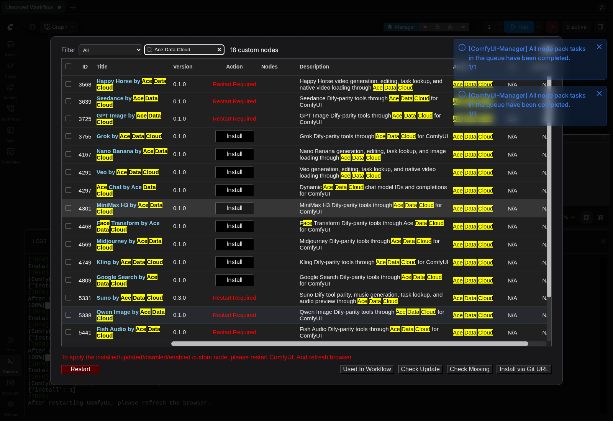

# Ace Data Cloud 的 ComfyUI Veo 节点

通过 Ace Data Cloud 生成和编辑 Veo 视频，按**同一个任务 ID**查询完成结果，再把视频作为 ComfyUI 原生 `VIDEO` 使用。节点调用云 API，无需本地显卡。收费以[当前 Veo 价格](https://platform.acedata.cloud/models?utm_source=comfyui&utm_medium=referral&utm_campaign=evergreen&utm_content=veocomfyui_readme_zh_cn_pricing)为准。

[English guide](../README.md)

## 官方安装

打开官方 [Veo by Ace Data Cloud Registry页面](https://registry.comfy.org/nodes/veo)，或在 **Manager → Custom Nodes Manager** 搜索 **Veo**；核对下述Ace发布者/源码，找不到时再搜 **Ace Data Cloud**。选择 **Veo by Ace Data Cloud**，核对发布者 **acedatacloud** 和源码仓库 [`AceDataCloud/VeoComfyUI`](https://github.com/AceDataCloud/VeoComfyUI)，再点击 **Install**。在 **Select Version** 版本对话框明确选择已批准的 Registry 稳定版 **0.1.0**；普通对话框可能默认高亮 **nightly**，本教程不要直接接受该选项。保留依赖自动安装。出现 **Restart Required** 后重启 ComfyUI，并刷新浏览器。Registry ID 为 `veo`。

这条 Registry 稳定版安装路径已于 **2026-10-16 在原版 Linux CPU ComfyUI 0.41.0** 验证；该次安装验收没有提交生成或聊天请求。更新的宿主版本及每个收费动作仍需分别验证，模型可用性与价格以当前服务规则为准。




以上为 **2026-10-16 Linux ComfyUI0.41.0** 原图，不是新服务词实拍或收费请求；见[来源与限制](screenshot-sources.json)。

## 获取 API Key

### 复制或创建自己的 API Token

注册/登录Ace后打开**应用 → 通用应用**；无通用应用时先初始化。复制有本服务权限的已有Token，或用**管理Key → 创建**单独命名为`ComfyUI`。先核权限、有效期/允许API、Credits余额与当前价格。


以上是 **2026-10-08** SunoDify中的真实脱敏原图，第二图的示例名`Dify tutorial`在此改为`ComfyUI`，本次未创建Key。Token只配置在**实际启动ComfyUI的进程环境**`ACEDATACLOUD_API_KEY`中并重启；节点没有图示的Key输入框，不要填到prompt/JSON/工作流/截图。另一个终端的export不能配置已运行的Desktop进程。

1. 登录 [Ace Data Cloud → 应用](https://platform.acedata.cloud/console/applications?utm_source=comfyui&utm_medium=referral&utm_campaign=evergreen&utm_content=veocomfyui_readme_zh_cn_api_key)。新账户没有通用应用时，先选择**初始化通用应用**。
2. 打开**通用应用**，确认已开通本节点使用的服务。单服务应用的 Key 只限该服务。可复制已有 API Key；需要独立 Key 时，选择**管理 Key → 创建**，命名为 `ComfyUI`。
3. 只复制 Token 字符串，不加 `Bearer ` 或引号。平台管理 Token 不能代替节点调用 API 的 Key。若启用**允许的 API**限制，需同时包含工作流用到的提交和任务查询路径；收费动作前核对当前价格与 Credits 余额。

本包覆盖当前 [VeoDify](https://github.com/AceDataCloud/VeoDify) 的 **5 个 model ID 与 7 个工具定义**：文生视频、首尾帧图生视频、多图融合、`get1080p`、延长、物体增删、镜头重拍、清晰度提升、单任务/批量查询。额外的 Load Video 节点把结果接入 ComfyUI `VIDEO`。

## 安装与 Key

源码安装：

```bash
cd /path/to/ComfyUI/custom_nodes
git clone https://github.com/AceDataCloud/VeoComfyUI.git
cd VeoComfyUI
python -m pip install -r requirements.txt
```

要求 ComfyUI 0.39.0 或更新版本。终端启动时，在同一私有终端配置有Veo权限的Token后启动：

```bash
export ACEDATACLOUD_API_KEY='在此粘贴自己的Token'
python main.py --cpu
```

Token应位于**实际 ComfyUI 进程环境**的 `ACEDATACLOUD_API_KEY`（也接受 `ACEDATACLOUD_API_TOKEN`），然后重启。不要把 Key 写进工作流、仓库或截图。

## 使用

导入 [01-submit-text-to-video.json](../examples/01-submit-text-to-video.json)，选定模型和价格后只运行一次，记录任务 ID。`veo3`、`veo3-fast`、`veo31`、`veo31-fast` 可用于文生视频或 1–2 张图的首尾帧视频；`veo31-fast-ingredients` 只用于 1–3 张参考图融合。输入公开 HTTPS URL，可用 JSON 数组或每行一条。4k 仅限 Veo 3.1 模型。

延长支持 `veo31-fast` 和 `veo31`。物体增删和镜头重拍要求原视频 ID，不能用延长结果；移除物体需要公开 HTTPS 蒙版 URL。`get1080p`、Upsample 使用已有视频 ID，不能填视频 URL。

导入 [02-retrieve-and-save.json](../examples/02-retrieve-and-save.json)，填入**同一个任务 ID**，运行 **Retrieve Task → Load Video → Save Video**。240 秒后仍 pending 时，只重跑查询工作流。批量查询节点可查询 1–20 个已有 ID。

提交超时或 HTTP 5xx 时，先到 [Ace Data Cloud 控制台](https://platform.acedata.cloud/console/applications?utm_source=comfyui&utm_medium=referral&utm_campaign=evergreen&utm_content=veocomfyui_readme_zh_cn_api_key)按任务或 Trace ID 核对是否受理，再决定是否重新收费提交。详见[隐私说明](PRIVACY.md)。

## 同任务刷新与取消限制

导入收费提交图前关闭自动队列/自动运行，明确只提交一次。本版未实现任务缓存刷新hook或可中断轮询回调；同输入查询仍返回旧pending时，改`wait_seconds`（如240改239）并**只查同一任务ID**以失效缓存，不要重跑生成。Stop可能需等轮询/HTTP超时，不撤销或退款远端已接受任务；`wait_seconds=0`可用于显式单次状态查询。不要把Top5的独立运行时修复当成本包已具备。

## 排错

| 现象 | 处理 |
| --- | --- |
| 缺Key/401 | 配实际启动进程的API Token并重启；管理Token不能替代API Key |
| 403 | 读具体权限/有效期/允许路径或内容限制原因，不盲目重发 |
| 429 | 等限流恢复，保留已接受任务ID，不重复付费提交 |
| JSON/模型/字段无效 | 按工具字段修正，示例`{}`/URL只是占位 |
| 超时/5xx | 再付费提交前查控制台请求/Trace记录 |
| 结果或媒体异常 | 按本服务同步/异步说明检查；pending不冒充成品 |
